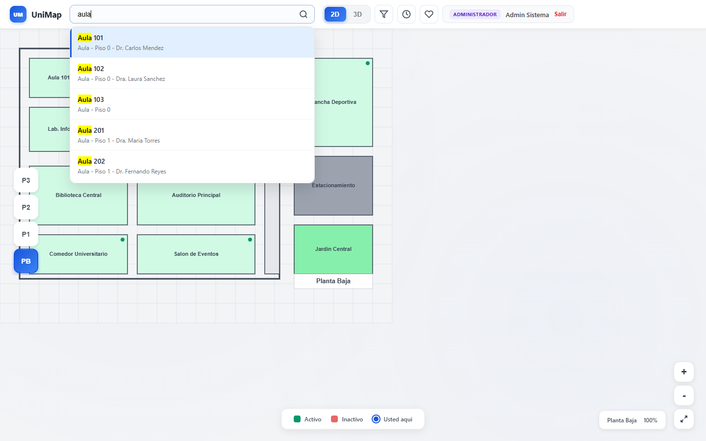
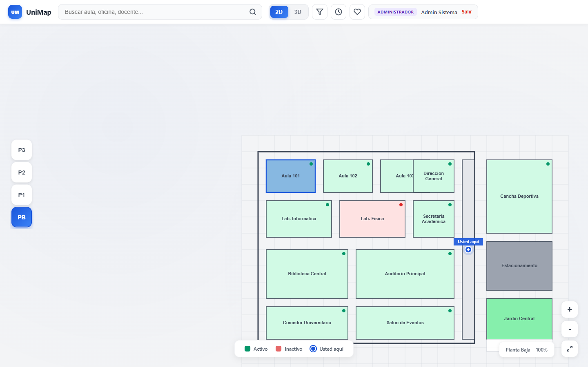
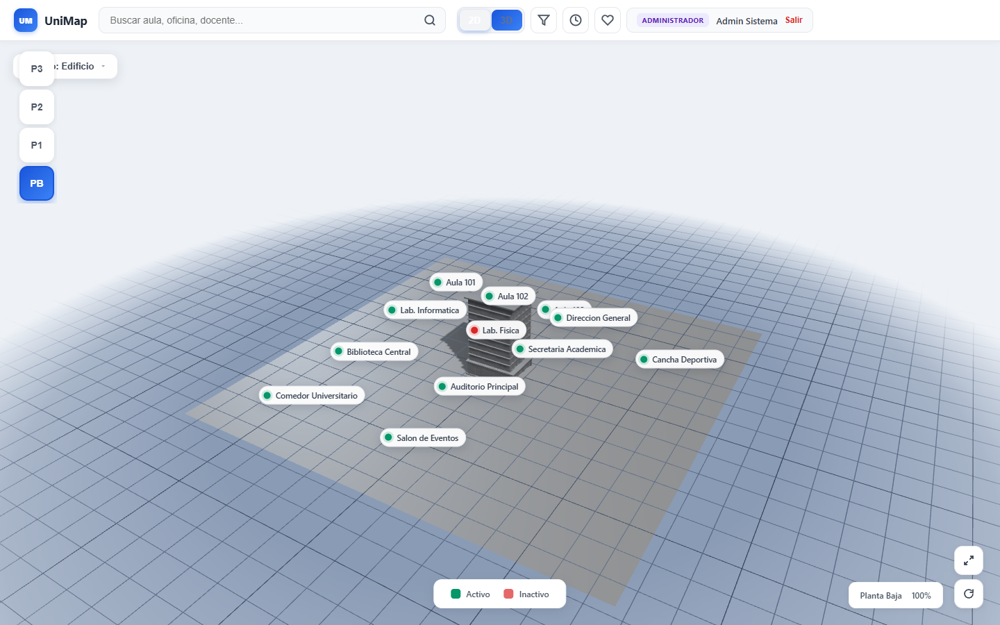
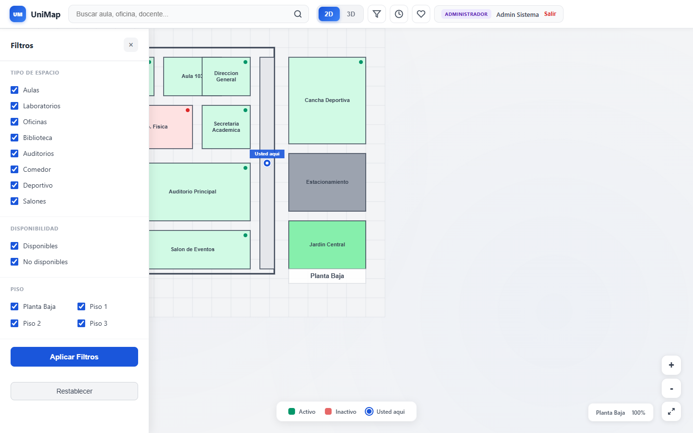
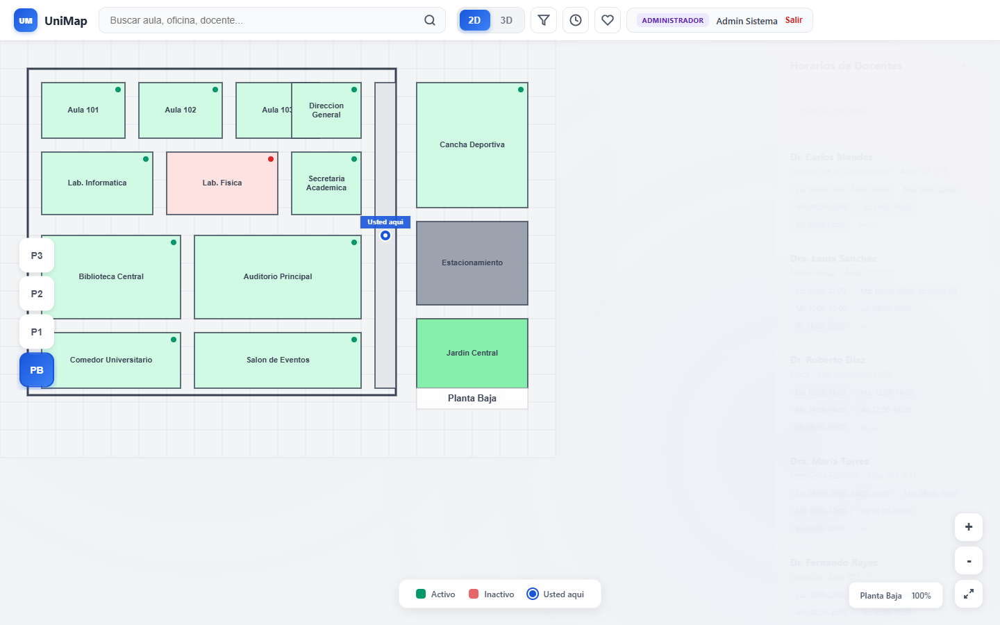
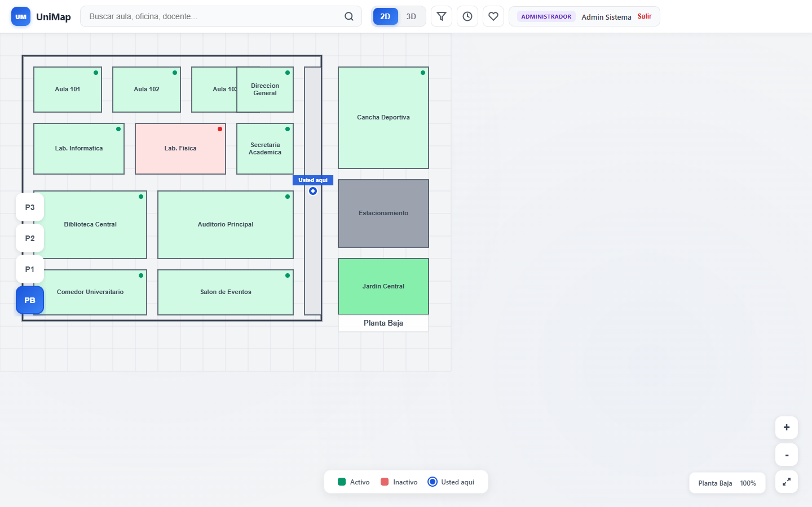

# UniMap — Campus Universitario


Mapa interactivo de campus con **dos torres integradas** (Torre Antigua y Torre
Innovación, **17 pisos en total**), **plano 2D** (canvas) y **visor 3D campus**
(Three.js, ambas torres en la misma escena), con autenticación, filtros, buscador,
horarios y favoritos. Incluye el **frontend** (sin dependencias externas, funciona
100 % offline) y el **backend** (API REST en Laravel + Supabase/PostGIS).

| | |
|---|---|
| **Abrir la aplicación** | Doble clic en `INICIAR.bat` → <http://localhost:8080> |
| **Manual de usuario** | [`MANUAL-USUARIO.md`](MANUAL-USUARIO.md) |
| **Guía de contribución** | [`CONTRIBUTING.md`](CONTRIBUTING.md) |
| **Estructura del proyecto** | [`ESTRUCTURA.md`](ESTRUCTURA.md) |
| **Historial de versiones** | [`CHANGELOG.md`](CHANGELOG.md) |
| **Tablero de tareas** | <https://github.com/users/eelhuevo/projects/1> |
| **Release** | [`v1.0.0`](https://github.com/eelhuevo/MapaInteractivo/releases/tag/v1.0.0) |

---

## Estado del proyecto

| Qué | Dónde |
|---|---|
| Rama de **entrega v1.0** (todo el trabajo integrado) | [`beta`](https://github.com/eelhuevo/MapaInteractivo/tree/beta) |
| Rama principal **protegida** (línea base + revisiones del equipo) | [`main`](https://github.com/eelhuevo/MapaInteractivo/tree/main) |
| Tareas registradas | [Issues #36–#51](https://github.com/eelhuevo/MapaInteractivo/issues?q=is%3Aissue) |
| Entregas del equipo | [Pull Requests #52–#75](https://github.com/eelhuevo/MapaInteractivo/pulls?q=is%3Apr) |
| Verificación automática de commits | [`.github/workflows/convencion-commits.yml`](.github/workflows/convencion-commits.yml) → *Verificar* |
| Plantillas de issues y PRs | [`.github/`](.github) |
| Discusiones del equipo | <https://github.com/eelhuevo/MapaInteractivo/discussions> |

La rama `beta` es la **entrega**: contiene los 16 trabajos del equipo más las
correcciones, con un **100 % de commits que siguen la convención** del proyecto
(`tipo(ámbito): descripción`). Cada entrega se hizo en su **rama propia** y se
abrió como **Pull Request**, como se explica en [`CONTRIBUTING.md`](CONTRIBUTING.md).

---

## El equipo

Cada integrante del proyecto, con su perfil, sus issues y sus entregas. Los
enlaces a "commits" muestran directamente el trabajo de cada persona en la rama
de entrega.

| Integrante | Perfil | Área del proyecto | Commits | Issues | Pull Requests |
|---|---|---|---|---|---|
| **eelhuevo** | [@eelhuevo](https://github.com/eelhuevo) | Modelo de datos, estado global, autenticación, documentación | [commits](https://github.com/eelhuevo/MapaInteractivo/commits/beta?author=eelhuevo) | [#36](https://github.com/eelhuevo/MapaInteractivo/issues/36) [#37](https://github.com/eelhuevo/MapaInteractivo/issues/37) [#38](https://github.com/eelhuevo/MapaInteractivo/issues/38) [#51](https://github.com/eelhuevo/MapaInteractivo/issues/51) | [#53](https://github.com/eelhuevo/MapaInteractivo/pull/53) [#57](https://github.com/eelhuevo/MapaInteractivo/pull/57) [#58](https://github.com/eelhuevo/MapaInteractivo/pull/58) [#59](https://github.com/eelhuevo/MapaInteractivo/pull/59) [#60](https://github.com/eelhuevo/MapaInteractivo/pull/60) [#61](https://github.com/eelhuevo/MapaInteractivo/pull/61) [#62](https://github.com/eelhuevo/MapaInteractivo/pull/62) [#63](https://github.com/eelhuevo/MapaInteractivo/pull/63) [#64](https://github.com/eelhuevo/MapaInteractivo/pull/64) [#65](https://github.com/eelhuevo/MapaInteractivo/pull/65) [#66](https://github.com/eelhuevo/MapaInteractivo/pull/66) [#67](https://github.com/eelhuevo/MapaInteractivo/pull/67) [#68](https://github.com/eelhuevo/MapaInteractivo/pull/68) [#69](https://github.com/eelhuevo/MapaInteractivo/pull/69) [#70](https://github.com/eelhuevo/MapaInteractivo/pull/70) [#71](https://github.com/eelhuevo/MapaInteractivo/pull/71) |
| **moisesAlejandro78** | [@moisesAlejandro78](https://github.com/moisesAlejandro78) | Modelado 3D en Blender (edificio principal, oficinas, torre antigua) | [commits](https://github.com/eelhuevo/MapaInteractivo/commits/beta?author=moisesAlejandro78) | [#39](https://github.com/eelhuevo/MapaInteractivo/issues/39) [#40](https://github.com/eelhuevo/MapaInteractivo/issues/40) [#41](https://github.com/eelhuevo/MapaInteractivo/issues/41) | [#72](https://github.com/eelhuevo/MapaInteractivo/pull/72) [#73](https://github.com/eelhuevo/MapaInteractivo/pull/73) [#74](https://github.com/eelhuevo/MapaInteractivo/pull/74) [#75](https://github.com/eelhuevo/MapaInteractivo/pull/75) |
| **Jhoselinconde537-lang** | [@Jhoselinconde537-lang](https://github.com/Jhoselinconde537-lang) | Cargadores de Three.js (glTF y FBX) y modelo FBX de la torre B | [commits](https://github.com/eelhuevo/MapaInteractivo/commits/beta?author=Jhoselinconde537-lang) | [#42](https://github.com/eelhuevo/MapaInteractivo/issues/42) [#43](https://github.com/eelhuevo/MapaInteractivo/issues/43) [#44](https://github.com/eelhuevo/MapaInteractivo/issues/44) | [#64](https://github.com/eelhuevo/MapaInteractivo/pull/64) [#65](https://github.com/eelhuevo/MapaInteractivo/pull/65) [#66](https://github.com/eelhuevo/MapaInteractivo/pull/66) |
| **Oslo144** | [@Oslo144](https://github.com/Oslo144) | Interfaz: barra superior, paneles laterales y ficha flotante del espacio | [commits](https://github.com/eelhuevo/MapaInteractivo/commits/beta?author=Oslo144) | [#45](https://github.com/eelhuevo/MapaInteractivo/issues/45) [#46](https://github.com/eelhuevo/MapaInteractivo/issues/46) [#47](https://github.com/eelhuevo/MapaInteractivo/issues/47) | [#54](https://github.com/eelhuevo/MapaInteractivo/pull/54) [#55](https://github.com/eelhuevo/MapaInteractivo/pull/55) [#56](https://github.com/eelhuevo/MapaInteractivo/pull/56) [#57](https://github.com/eelhuevo/MapaInteractivo/pull/57) [#67](https://github.com/eelhuevo/MapaInteractivo/pull/67) [#68](https://github.com/eelhuevo/MapaInteractivo/pull/68) |
| **ItsMegabo11** | [@ItsMegabo11](https://github.com/ItsMegabo11) | Sistema de diseño, buscador de espacios y adaptación a móvil y tablet | [commits](https://github.com/eelhuevo/MapaInteractivo/commits/beta?author=ItsMegabo11) | [#48](https://github.com/eelhuevo/MapaInteractivo/issues/48) [#49](https://github.com/eelhuevo/MapaInteractivo/issues/49) [#50](https://github.com/eelhuevo/MapaInteractivo/issues/50) | [#69](https://github.com/eelhuevo/MapaInteractivo/pull/69) [#70](https://github.com/eelhuevo/MapaInteractivo/pull/70) [#71](https://github.com/eelhuevo/MapaInteractivo/pull/71) |

> La participación individual también se refleja en las **revisiones**: cada Pull
> Request necesita una aprobación de otro miembro del equipo antes de integrarse
> (`main` está protegida y exige 1 revisión aprobatoria + la verificación
> automática *Verificar*).

---

## Capturas

| Vista 2D | Buscador | Ficha del espacio | Vista 3D |
|---|---|---|---|
|  |  |  |  |

| Panel de filtros | Horarios de docentes | Pantalla de acceso |
|---|---|---|
|  |  |  |

---

## Cómo ejecutar

### Frontend (recomendado, necesario para la vista 3D)

Doble clic en **`INICIAR.bat`** → abre `http://localhost:8080` en el navegador
(requiere Python 3).

> La vista 3D descarga los modelos `.glb` / `.fbx` por HTTP. Si abres `index.html`
> directamente con doble clic (`file://`), el navegador bloquea esa descarga por
> política CORS y el visor mostrará un aviso. El mapa 2D, filtros, buscador,
> horarios y favoritos sí funcionan igualmente.

También puedes servir la carpeta con:

```bash
python -m http.server 8080
```

### Cuenta de prueba

| Correo | Contraseña | Rol |
|---|---|---|
| `admin@uni.edu` | `123456` | Administrador |

También puedes registrarte desde la propia pantalla o entrar como **Invitado**.

### Backend (API REST)

Requiere **PHP >= 8.4.1** con las extensiones `pdo_pgsql`, `pgsql`, `fileinfo` y
`zip`:

```bash
cd backend
cp .env.example .env   # completa tus credenciales de Supabase
composer install
php artisan serve
```

---

## Documentación

| Documento | Para qué sirve |
|---|---|
| [`MANUAL-USUARIO.md`](MANUAL-USUARIO.md) | **Manual de usuario**: cómo entrar, usar el mapa 2D y 3D, filtros, búsqueda, horarios y favoritos |
| [`CONTRIBUTING.md`](CONTRIBUTING.md) | **Guía de contribución**: flujo de trabajo, convención de commits, Pull Requests y versiones |
| [`ESTRUCTURA.md`](ESTRUCTURA.md) | **Estructura del proyecto**: qué hay en cada carpeta y para qué sirve |
| [`CHANGELOG.md`](CHANGELOG.md) | **Historial de versiones** del proyecto |
| `README.md` (este) | Documentación técnica: estructura, cómo ejecutar, funcionalidad |
| Plantillas en `.github/` | Formulario para Pull Requests e issues |

---

## Estructura

```
unimap/
├── index.html              → pantalla de acceso (login / registro / invitado)
├── INICIAR.bat             → servidor local del frontend (requiere Python 3)
├── README.md
│
├── frontend/               → código del mapa interactivo
│   ├── mapa.html           → mapa 2D + visor 3D + paneles
│   ├── admin.html          → panel de administración
│   │
│   ├── css/                → estilos divididos por capítulo
│   │   ├── base.css        → variables, reset, botones, animaciones, avisos
│   │   ├── auth.css        → pantalla de autenticación
│   │   ├── map.css         → barra superior, buscador, pisos, lienzo, leyenda, zoom
│   │   ├── panels.css      → paneles de filtros, horarios y favoritos
│   │   ├── components.css  → tooltip, resultados de búsqueda, favoritos
│   │   ├── view3d.css      → visor 3D, marcadores, selector de modelos, carga
│   │   ├── admin.css       → panel de administración
│   │   └── responsive.css  → ajustes a distintos tamaños de pantalla
│   │
│   ├── js/
│   │   ├── app.js          → arranque de la pantalla del mapa
│   │   ├── core/
│   │   │   ├── store.js        → namespace global, estado, storage y utilidades
│   │   │   ├── ui.js           → pantalla, conmutador 2D/3D, navegación a espacios
│   │   │   ├── i18n.js         → textos del interfaz
│   │   │   ├── avisos.js       → notificaciones
│   │   │   ├── estadisticas.js → métricas de uso
│   │   │   └── personalizacion.js → preferencias del usuario
│   │   ├── data/
│   │   │   ├── categorias.js / edificios.js / docentes.js / espacios.js
│   │   ├── auth/auth.js    → login, registro, invitado y sesión
│   │   ├── admin/admin.js  → gestión de espacios y usuarios
│   │   ├── map/
│   │   │   ├── tooltip.js / map2d.js / filtros.js
│   │   │   ├── busqueda.js / horarios.js / favoritos.js
│   │   │   ├── ruta.js / qr.js / servicios.js / sugerencias.js
│   │   └── view3d/viewer3d.js  → escena Three.js, modelos, marcadores 3D
│   │
│   ├── vendor/three/       → Three.js r147 en local (sin CDN)
│   └── models/             → modelos 3D del campus (.glb / .fbx)
│       ├── torre-antigua-banos.glb / torre-antigua-conexion.glb / torre-antigua-cursos.glb
│       ├── torre-innovacion-pisos-6-10.glb / torre-innovacion-plantilla.glb
│       ├── edificio.glb / oficinas.glb / planta-baja-torre-b.fbx
│
├── backend/                → API REST (Laravel + Supabase/PostGIS)
│   ├── app/                → controladores, modelos, middleware, resources
│   ├── database/           → migraciones + seeders del campus
│   ├── routes/api.php      → endpoints de la API
│   ├── docs/               → backlog de usuario y documentación
│   └── .env                → configuración (no se sube al repositorio)
│
└── docs/
    └── capturas/           → imágenes del README y del manual de usuario
```

---

## Funcionalidad

- **Dos torres, 17 pisos**: Torre Antigua (PB–P7) y Torre Innovación (PB–P8), con
  conmutador TA/TI y selector de pisos dinámico según la torre activa.
- **Autenticación**: login, registro con validaciones y medidor de fortaleza, sesión
  persistente y acceso como invitado.
- **Mapa 2D**: plano en canvas con paneo (ratón/dedo/lápiz), zoom (rueda y pellizca),
  selector de pisos, hover y clic con ficha completa.
- **Visor 3D campus**: ambas torres cargadas e integradas en la misma escena; los
  marcadores se posicionan sobre la torre correcta y a la altura del piso seleccionado
  (offset Y automático). Selector de modelos individuales para inspección.
- **Filtros**: 8 tipos de espacio, disponibilidad, pisos y torre (con efecto real en
  ambas vistas).
- **Búsqueda** en vivo por nombre, tipo, docente o departamento, con resultados
  navegables (muestra torre y piso).
- **Horarios** de los 8 docentes con buscador y salto al aula correspondiente.
- **Favoritos** por usuario (localStorage), ocultos para invitados.
- **Teclado**: `Escape` cierra fichas/paneles/listas; `Enter` abre el primer resultado.

---

## Cómo trabajamos

```
Issue asignado  →  Rama propia  →  Commit  →  Push  →  Pull Request  →  Revisión  →  Merge
```

1. Cada tarea tiene su **issue** (`#36`–`#51`) con responsable, etiquetas y
   criterio de aceptación.
2. Cada persona trabaja en una **rama propia** (`feature/...`).
3. Cada cambio es un **commit** con la convención
   `tipo(ámbito): descripción en minúsculas`.
4. La verificación automática **`Verificar`** rechaza los commits y los títulos de PR
   que no la siguen.
5. Otro miembro del equipo **revisa y aprueba** el Pull Request.
6. La rama `main` está **protegida**: solo entra código revisado.

El detalle está en [`CONTRIBUTING.md`](CONTRIBUTING.md).

---

## Notas técnicas

- Arquitectura: HTML/CSS/JS vanilla con módulos IIFE que exponen `window.UniMap`.
- Three.js **r147** (última con builds globales no modulares): sin build ni proceso de
  compilación; todo se carga con `<script>` clásicos. Las librerías de
  `frontend/vendor/three/` son copia local del código original de Three.js
  (licencia MIT); solo se añadieron las cabeceras de procedencia.
- Los datos de usuario y favoritos viven en `localStorage`: prototipo académico.
  La integración con la API está prevista como siguiente paso.
- **Backend** (`backend/`): API REST en Laravel con Sanctum, PostgreSQL/PostGIS vía
  Supabase. Requiere **PHP >= 8.4.1**. Ejecutar con `php artisan serve` desde
  `backend/`. La integración del frontend con esta API está pendiente de implementarse.
